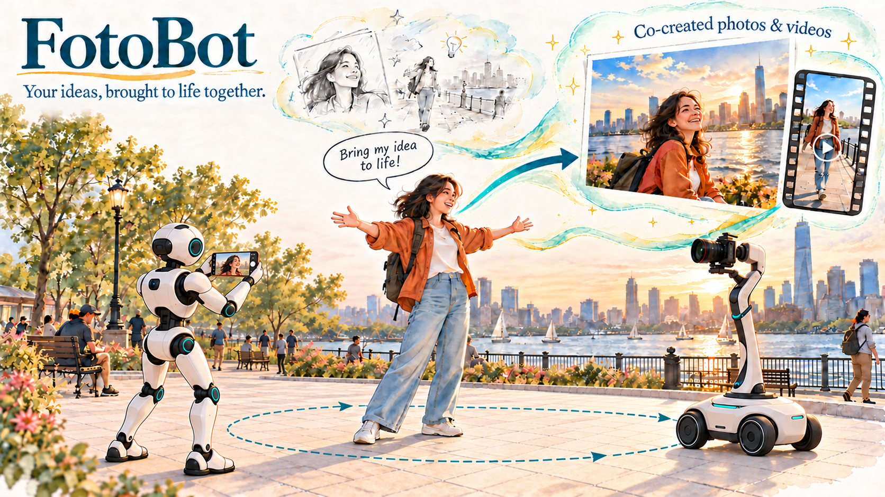

# What is FotoBot?

Advances in large language models (LLMs) have opened new possibilities for robots to operate in open, real-world environments. As these capabilities develop towards superintelligence (SI), robots could autonomously handle more everyday tasks, giving people more time to travel, create, and share their experiences. Yet **turning personal creative ideas into cultural artefacts**, such as drawings, photographs, and vlogs, can be difficult without the necessary skills. Capturing a compelling photograph or producing a polished vlog can require professional expertise or even an entire production team.

Could SI make creative expression more accessible by enabling robots to become *creative partners*? Robots have traditionally focused on utilitarian tasks with clearly defined goals. Creative human-robot collaboration also requires robots to respond to personal intentions, aesthetic preferences, and subjective judgements. This vision motivates the *FotoBot* series, which explores how robots can become interactive partners in the creative process. Our mission is to **help everyone bring their creative ideas to life, without requiring professional skills.**

Since launching the project in 2024, we have explored several aspects of robotic photography and videography. Our work draws on advanced SI techniques and has spanned three areas. These include an LLM-integrated system prototype ([FotoBot](#fotobot)), autonomous portrait photography algorithms and urban service workflows ([LEAP](#leap)), and camera following and motion control for [vlog recording](#vlog). Our approach combines aesthetic judgement with safe, adaptive operation in dynamic public spaces. For user interaction, we provide a comprehensive, privacy-preserving service workflow that makes image capture and storage transparent to users. The workflow also uses a GPT model to parse user prompts and interpret their intent. Extensive deployment experiments have demonstrated the feasibility of operating these systems in real urban environments.

In parallel, we are exploring three directions for future work:

- An agent-harnessed photography system that adapts to free-form user instructions across diverse scenarios.
- Recursive self-evolving (RSI) methods for automatic improvement and adaptation to individual preferences.
- A library of camera motion skills for vlog recording, including dolly-in and dolly-out movements, orbit shots, and lateral tracking.

Through these efforts, we envision robots supporting people and collaborating with them to create cultural artifacts. We hope to **make robotic creative assistance an efficient, reliable, and accessible part of everyday life** in the near future.

**Author:** Chang Chen
**Date:** 25 October 2026
**Team:** Chang Chen, Dawei Wang, Ruixing Jia, Lei Yang, Marc Christie, Jia Pan
**Institutions:** The University of Hong Kong, University of Rennes, LimX Dynamics, Shenzhen Loop Area Institute

---

# Our work

### FotoBot: LLM-integrated photography prototype 
Paper: [FotoBot: an embodied AI photography robot system its design, prototyping and application](https://www.elspub.com/doi/10.55092/rl20260019)

Developed by Dawei Wang.

<video src="demos/preview/大维版demo.webm" controls preload="metadata" width="100%">
  <a href="demos/大维版demo.mp4">FotoBot: LLM-integrated photography prototype</a>
</video>

### LEAP: learning embodied aesthetics for photography 
Paper: [Autonomous robotic photography as a creative urban service](https://www.researchsquare.com/article/rs-11118236/v1)

Developed by Chang Chen.

1) Pipeline and results summary.
  
<video src="demos/preview/LEAP%20nature_cities_final.webm" controls preload="metadata" width="100%">
  <a href="demos/LEAP%20nature_cities_final.mp4">LEAP-1</a>
</video>

2) A one-day deployment in Shenzhen Talent Park.
   
<video src="demos/preview/5_one_day_deployment.webm" controls preload="metadata" width="100%">
  <a href="demos/5_one_day_deployment.mp4">LEAP-2</a>
</video>

### Robotic vlog recording 
Developed by Ruixing Jia.
<video src="demos/preview/pixbot-demo-tech--ruixing.webm" controls preload="metadata" width="100%">
  <a href="demos/pixbot-demo-tech--ruixing.mp4">Robotic vlog recording</a>
</video>

---
If you are interested in this research direction, please follow our work or contact us by email (changchen@connect.hku.hk) to discuss potential collaborations.

