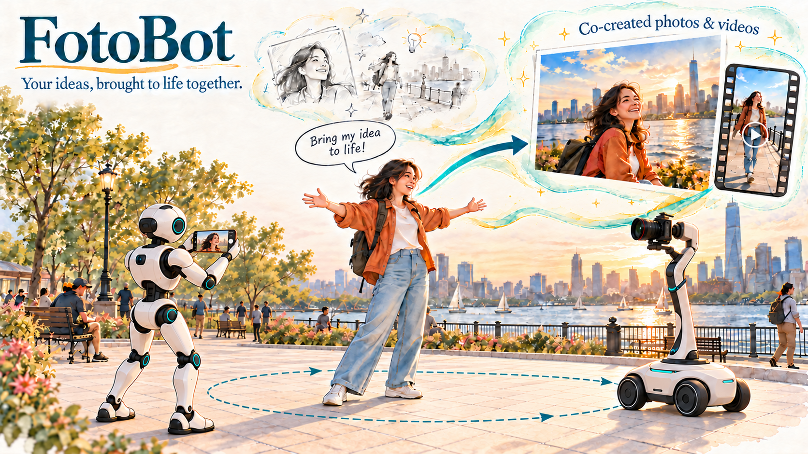

# 什么是 FotoBot？ 

大语言模型（LLM）的进展，为机器人在开放的真实环境中工作带来了新的可能。随着这些能力向超级智能（SI）发展，机器人有望自主承担更多日常任务，让人们有更多时间旅行、创作和分享生活。然而，如果缺乏相应技能，**将个人创意转化为绘画、照片和视频博客（vlog）等文化作品**并不容易。拍出一张出色的照片，或制作一段精良的 vlog，往往需要专业知识，甚至需要整个制作团队的支持。

超级智能能否让机器人成为人们的*创作伙伴*，让更多人轻松表达创意？传统机器人主要面向目标明确的实用任务，而创意性人机协作还要求机器人理解个人意图、审美偏好和主观判断。这一愿景推动了 *FotoBot* 系列研究，探索机器人如何成为创作过程中的交互式伙伴。我们的使命是：**让每个人都能将创意变为现实，无需具备专业技能。**

自 2024 年启动项目以来，我们围绕机器人摄影与视频拍摄开展了多方面探索。研究借助先进的超级智能技术，涵盖三个方向：集成大语言模型的系统原型（[FotoBot](#fotobot)）、自主肖像摄影算法与城市服务流程（[LEAP](#leap)），以及面向 [vlog 拍摄](#vlog)的相机跟随与运动控制。我们的方法将审美判断与安全、自适应的机器人运行相结合，以适应动态公共空间。在人机交互方面，我们提供了完整且注重隐私保护的服务流程，让用户清楚了解图像的拍摄与存储方式。该流程还使用 GPT 模型解析用户指令、理解用户意图。大量实地部署实验验证了这些系统在真实城市环境中运行的可行性。

与此同时，我们正在探索以下三个未来研究方向：

- 基于智能体运行框架的摄影系统，能够在多种场景中响应用户以自然语言自由表达的指令。
- 递归自我改进（RSI）方法，实现系统自动改进并适应个人偏好。
- 面向 vlog 拍摄的相机运动技能库，涵盖推近、拉远、环绕拍摄和横向跟拍等运镜方式。

通过这些探索，我们希望机器人能够为人们提供支持，与人协作创作文化作品。我们期待在不久的将来，**让机器人创作辅助高效、可靠地融入日常生活，并让每个人都能便捷使用。**

**Author:** [Chang Chen](https://scholar.google.com/citations?user=1jx4TqkAAAAJ&hl=en)
**Date:** 2026 年 10 月 25 日
**Team:** [Chang Chen](https://scholar.google.com/citations?user=1jx4TqkAAAAJ&hl=en)、[Dawei Wang]()、[Ruixing Jia]()、[Lei Yang]()、[Marc Christie]()、[Jia Pan]()
**Institutions:** 香港大学、雷恩大学、逐际动力、深圳河套学院

---

# 研究成果 

### FotoBot：集成大语言模型的摄影机器人原型 

论文：[FotoBot：具身智能摄影机器人系统的设计、原型开发与应用](https://www.elspub.com/doi/10.55092/rl20260019)

开发者：[Dawei Wang]()。

<video src="demos/preview/大维版demo.webm" controls preload="metadata" width="100%">
  <a href="demos/大维版demo.mp4">FotoBot：集成大语言模型的摄影机器人原型</a>
</video>

### LEAP：面向摄影的具身审美学习 

论文：[（*Nature Cities 审稿中*）作为创意城市服务的自主机器人摄影](https://www.researchsquare.com/article/rs-11118236/v1)

开发者：[Chang Chen](https://scholar.google.com/citations?user=1jx4TqkAAAAJ&hl=en)。

1) 系统流程与成果概览。

<video src="demos/preview/LEAP%20nature_cities_final.webm" controls preload="metadata" width="100%">
  <a href="demos/LEAP%20nature_cities_final.mp4">LEAP：系统流程与成果概览</a>
</video>

2) 在深圳人才公园开展的一日实地部署。

<video src="demos/preview/5_one_day_deployment.webm" controls preload="metadata" width="100%">
  <a href="demos/5_one_day_deployment.mp4">LEAP：一日实地部署</a>
</video>

### 机器人 vlog 拍摄 

开发者：[Ruixing Jia]()。

<video src="demos/preview/pixbot-demo-tech--ruixing.webm" controls preload="metadata" width="100%">
  <a href="demos/pixbot-demo-tech--ruixing.mp4">机器人 vlog 拍摄</a>
</video>

---

如果你对这一研究方向感兴趣，欢迎关注我们的工作，或通过电子邮件（[changchen@connect.hku.hk](mailto:changchen@connect.hku.hk)）联系我们，探讨潜在的合作机会。
